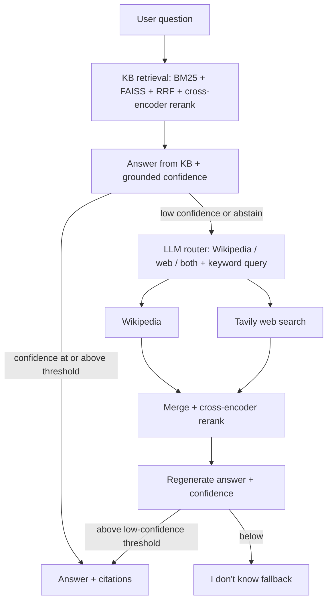

# InsightRAG v3

A multi-source research copilot. It answers questions from a private knowledge base first, and only escalates to Wikipedia and web search when the knowledge-base answer is not confident enough. It returns grounded answers with numbered citations and a documented confidence score.

**Stack:** Python, LangChain, Gemini (free tier), local sentence-transformers embeddings, FAISS + BM25 (RRF), cross-encoder reranking, FastAPI, Streamlit, Tavily, Prometheus metrics, RAGAS.

## How it works



Two routing modes are selectable with `ROUTING_MODE`:

- `fan_out`: query the KB, Wikipedia and web search on every question, then merge and rerank.
- `cascade_router`: answer from the KB first; escalate only when the KB-only answer's grounded confidence is below `CASCADE_KB_THRESHOLD` or the answer is the "I don't know" fallback.

**Confidence score:**

`C = round([0.65 * s_top + 0.35 * s_avg] * F_grounding, 4)`

Where `s_top` and `s_avg` are the top and average cross-encoder (sigmoid) scores of the retrieved chunks, and `F_grounding` is a penalty applied when the answer is not grounded in the retrieved passages.

If `C` falls below `LOW_CONFIDENCE_THRESHOLD`, the system answers:

> I don't know based on the available sources.

## Results

Evaluation on a 30-question golden set (12 KB, 9 Wikipedia, 9 web questions), split into 10 dev and 20 test questions.

All figures below are on the **20-question test split**, one run per question, `gemini-flash-lite-latest`, October 2026. Raw per-question results are in `eval/results/`.

| Metric | fan_out | cascade_router |
|---|---:|---:|
| Avg latency | 10.2 s | 5.5 s (46% lower) |
| P95 latency | 18.7 s | 11.4 s |
| Avg tokens per question | 1,688 | 1,479 |
| Avg cost per question (estimated) | $0.000169 | $0.000147 |
| KB hit rate (KB questions cite the right paper) | 75% (6/8) | 100% (8/8) |
| "I don't know" rate | 5% (1/20) | 15% (3/20) |
| Questions that skipped external sources | 0% | 40% (8/20) |

### RAGAS Evaluation

RAGAS (LLM-as-judge, Gemini), computed on the 16 questions that both modes answered:

| Metric | fan_out | cascade_router |
|---|---:|---:|
| Faithfulness | 0.793 | 0.833 |
| Answer relevancy | 0.877 | 0.879 |

Answer quality is comparable. The faithfulness difference is within the noise of 16 questions and an LLM judge, so it is not claimed as an improvement.

## Quick start

```powershell
python -m venv venv
venv\Scripts\Activate.ps1
python -m pip install -r requirements.txt
copy .env.example .env        # then add GEMINI_API_KEY and TAVILY_API_KEY
python -m scripts.fetch_kb    # downloads ~300 public arXiv CS abstracts into data/kb/
python -m scripts.ingest data/kb
python -m uvicorn app.api.main:app --port 8000
python -m streamlit run frontend/app.py
```

API: `POST /ask` with `{"query": "..."}`, `GET /health`, `GET /metrics` (Prometheus).

Each response includes the answer, citations (source type, file or URL, passage text), the confidence breakdown, routing mode and decision, sources queried, per-source and total latency, tokens and estimated cost.

### Configuration

Key settings in `.env`:

- `GEMINI_MODEL`
- `ROUTING_MODE` (`fan_out` or `cascade_router`)
- `CASCADE_KB_THRESHOLD` (default `0.5`)
- `LOW_CONFIDENCE_THRESHOLD` (default `0.35`)

## Reproduce the evaluation

```powershell
# set ROUTING_MODE=fan_out in .env and restart the API
python eval\run_eval.py --tag fanout_v2 --split test

# set ROUTING_MODE=cascade_router in .env and restart the API
python eval\run_eval.py --tag cascade_v2 --split test

python eval\run_ragas.py --tag fanout_v2 --delay 3     # needs ragas==0.2.14
python eval\run_ragas.py --tag cascade_v2 --delay 3

python eval\show_eval.py cascade_v2                    # per-question routing table
```

Responses are cached per tag in `eval/cache/`, so runs are resumable.

Use a new tag when you change the model, thresholds or sources.

## Design decisions

- **KB first, then escalate.** The private KB is the cheapest and most relevant source. Querying every source on every question was slower, more expensive, and let external results outrank the right paper (2 of 8 KB questions in fan-out were answered from the web instead).

- **Escalate on grounded confidence, not retrieval score.** A first version escalated on the raw retrieval score and failed: the cross-encoder scores loosely related chunks highly, so 9 of 12 Wikipedia and web test questions stayed on the KB and ended as "I don't know". The final grounded confidence separates the cases cleanly (every real KB answer scored 0.75 or higher, every failure 0.35 or lower), so the escalation rule uses that.

- **The router returns a short keyword query** for Wikipedia and web search instead of the raw question, and Wikipedia pages are fetched in full and split into passages (an intro-only fetch missed detail questions).

- **The default threshold of 0.5 was kept.** Given the wide gap above, any threshold between 0.4 and 0.7 routes the same way; a formal sweep was skipped.

- **Loud fallbacks.** Router and source failures log a warning and set `router_fallback`, so evaluation runs can exclude them.

## Limitations

- Small evaluation: 20 test questions, one run each, LLM-judged. Treat the numbers as directional.
- The golden set was drafted with AI assistance and is not independently human-verified. Web questions ("latest ...") change over time.
- The KB is about 300 arXiv abstracts (920 chunks), a controlled setting.
- The test split was inspected once before the escalation rule was revised; the rule change was then validated on the dev split, and the threshold was not tuned on test.
- Cascade abstains more often than fan-out (15% vs 5%), mostly on web questions.
- Costs are estimated from token counts; the runs used the free Gemini tier.
- RAGAS scores use a Gemini judge and are noisy; a few answers score 0 because of judging artifacts, in both modes.

## Project layout

```text
app/api/         FastAPI app, answer generation, confidence
app/retrieval/   hybrid retrieval, reranker, router, orchestration
app/sources/    KB, Wikipedia and Tavily sources
frontend/        Streamlit UI
scripts/         fetch_kb.py, ingest.py
eval/            golden_set.json, run_eval.py, run_ragas.py, results/
tests/            pytest suite (mocked sources and LLM)
```

## Roadmap

- User-uploaded document collections with isolated per-collection indexes
- Larger, human-verified golden set and repeated runs
- Optional response caching
